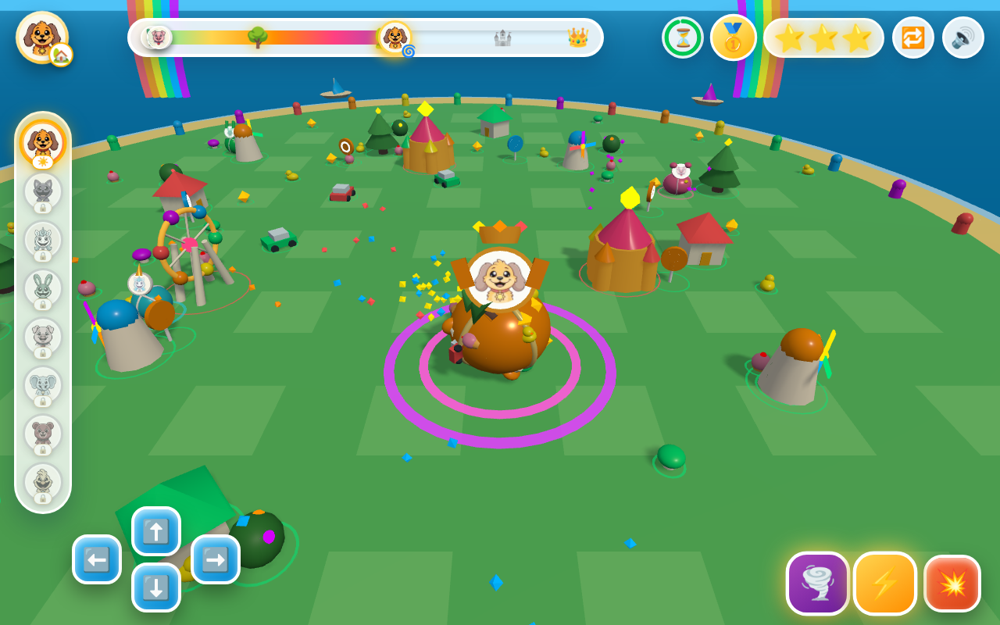

# 🌈 Critter Gobble 3D: Rainbow Toy Island! 🍭

**Play Live:** [https://kunruiw1991.github.io/critters-gobble3d/](https://kunruiw1991.github.io/critters-gobble3d/)

A 3D WebGL **Katamari- meets Hole.io-style Toy-Gobbling Arena Game** built with **Three.js** (`WebGLRenderer`, `PCFSoftShadowMap`, procedural 3D toy meshes, spring-chase camera, and Web Audio synthesizer) designed with a **100% Zero-Text Visual Cockpit** so young kids can play intuitively without reading a single word.

---

## ✨ 3D Engine & Gameplay Highlights

- **katamari 3D Toy-Sticking Physics (`stickPropToBall`)**:
  - Roll your 3D Critter Ball across a floating Rainbow Toy Island! Every smaller prop you touch (`prop.tier <= player.tier`) physically detaches from the island and **sticks onto the surface of your rotating 3D sphere**, tumbling around with your ball as you grow from a tiny marble into a giant island-eating colossus!
- **Always-Upright 3D Critter Portrait Medallion**:
  - Each of the 8 Smiling Critters rides inside a glowing 3D sphere with an upright billboarded portrait core (`icons/*.jpg`), custom signature colors, and a floating **3D Golden Crown** for whoever currently holds `1st Place` (`🥇`).
- **4-Tier Size Evolution & Dynamic Camera Pullback**:
  - **Tier 1 (`🌱`)**: Gobble Candy Cubes, Stars, Lollipops, Cupcakes, and Ducks!
  - **Tier 2 (`🌳`)**: Gobble Toy Cars, Gift Boxes, Mushrooms, and Pine Trees!
  - **Tier 3 (`🏡`)**: Gobble Cozy Toy Houses and Giant Rainbow Cakes!
  - **Tier 4 (`🏰`)**: Gobble Grand Toy Castles and Ferris Wheels!
  - Larger props feature pulsing red hazard rings until you grow big enough (`tier >= prop.tier`), at which point their rings turn **glowing green** (`#22c55e`) and a celebratory **SIZE UP!** shockwave unlocks the next tier!
- **3 Interactive Kid-Friendly Power Pedals**:
  - `🌪️` **Magnet Vortex** (`Key 1` / Left Pedal): Pulls all nearby edible toys and golden stars into your ball with a glowing purple vortex ring!
  - `⚡` **Dash Surge** (`Key 2` / `Space` / Center Pedal): Instant turbo speed burst with a golden speed-ring trail!
  - `💥` **Quake Slam** (`Key 3` / Right Pedal): Slams the island to scatter nearby rivals and pull edible toys inward!
- **Rainbow Fever Mode (`🌈🔥✨`)**:
  - Gobbling toys fills your Rainbow Fever Meter. At `100%`, your ball ignites in a cycling **HSL Rainbow Aura** with `1.42x` speed and automatic wide-radius toy attraction!
- **Bumper Knockback & Rival Gobbling**:
  - Slamming into a rival of similar size triggers a juicy 3D physics knockback, camera shake, and flying **star-coins** (`⭐`) that you can scoop up!
  - If you grow `20%+` larger than a rival Critter, you **gobble the entire rival**, launching them into the sky in a burst of confetti before they respawn!

---

## 🏆 5-Critter Podium & Top-3 Qualification Rules

Every match pits **You + 4 AI Critter Rivals** (`5 Critters total`) on a floating island:

| Final Rank | Star Reward | Outcome |
| :--- | :---: | :--- |
| **🥇 1st Place** | ⭐⭐⭐ (`3 Stars`) | **Champion Victory!** Unlocks next island |
| **🥈 2nd Place** | ⭐⭐ (`2 Stars`) | **Silver Podium!** Unlocks next island |
| **🥉 3rd Place** | ⭐ (`1 Star`) | **Bronze Podium!** Unlocks next island |
| **😭 4th / 5th Place** | `0 Stars` | **Defeat!** Sad crying podium + Retry button (`🔄`) |

---

## 🏝️ 8 Smiling Critter Toy Islands

1. **🏝️ CatNap's Candy Meadow** (`#9b5de5`)
2. **🏖️ DogDay's Sunny Boardwalk** (`#ff9f1c`)
3. **🧁 PickyPiggy's Sweet Bakery** (`#ff70a6`)
4. **🎨 CraftyCorn's Rainbow Studio** (`#38bdf8`)
5. **⚡ KickinChicken's Turbo Park** (`#facc15`)
6. **🌸 Bobby's Blossom Garden** (`#fb5607`)
7. **🚀 Hoppy's Moonbounce Crater** (`#2ec4b6`)
8. **👑 Bubba's Royal Sky Castle** (`#6366f1`)

---

## 🧪 5-Round Iterative Testing & Calibration Summary

1. **Round 1 — Core 3D Engine & Toy-Sticking Prototype**: Built the Three.js WebGL island arena, procedural 3D toy generators (12 prop types across 4 tiers), Katamari surface-sticking matrix math, and 8 Critter character themes.
2. **Round 2 — Upright Critter Portrait Medallion & Visual Clarity**: Upgraded the ball from a raw tiled texture to a translucent glossy 3D outer shell with an always-upright Critter portrait medallion inside, plus pulsing green (`edible`) vs. red (`too big`) floor rings.
3. **Round 3 — 3 Interactive Power Pedals & Rainbow Fever**: Added the bottom cockpit with `🌪️ Magnet Vortex`, `⚡ Dash Surge`, and `💥 Quake Slam` pedals, plus the Rainbow Fever gauge (`🌈`).
4. **Round 4 — Bumper Star-Coin Drops & AI Difficulty Calibration**: Tuned AI rival steering, wandering, and speed scaling (`aiSpeedMult: 0.62 -> 0.88` across Islands 1–8) so kids comfortably win `1st Place (3⭐)` on early islands while facing an exciting race on later islands.
5. **Round 5 — 5-Critter Podium Ceremony & Top-3 Qualification Verification**: Verified both **Victory (`🥇/🥈/🥉`)** and **Defeat (`😭 4th/5th = 0⭐`)** flows, ensuring zero console errors and 60 FPS WebGL rendering.
